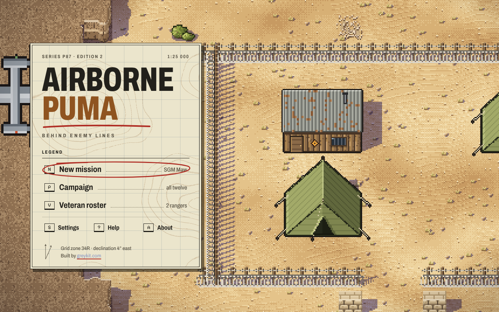
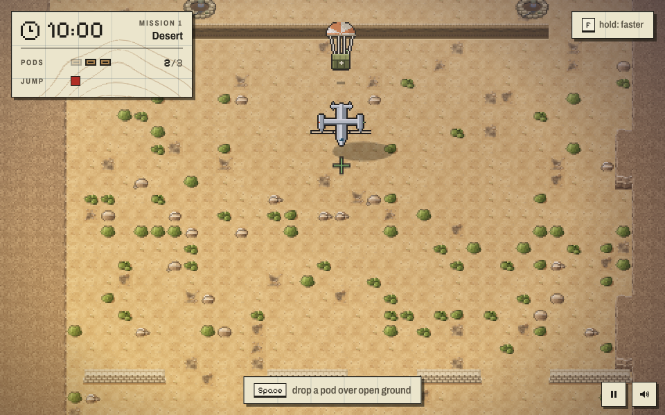
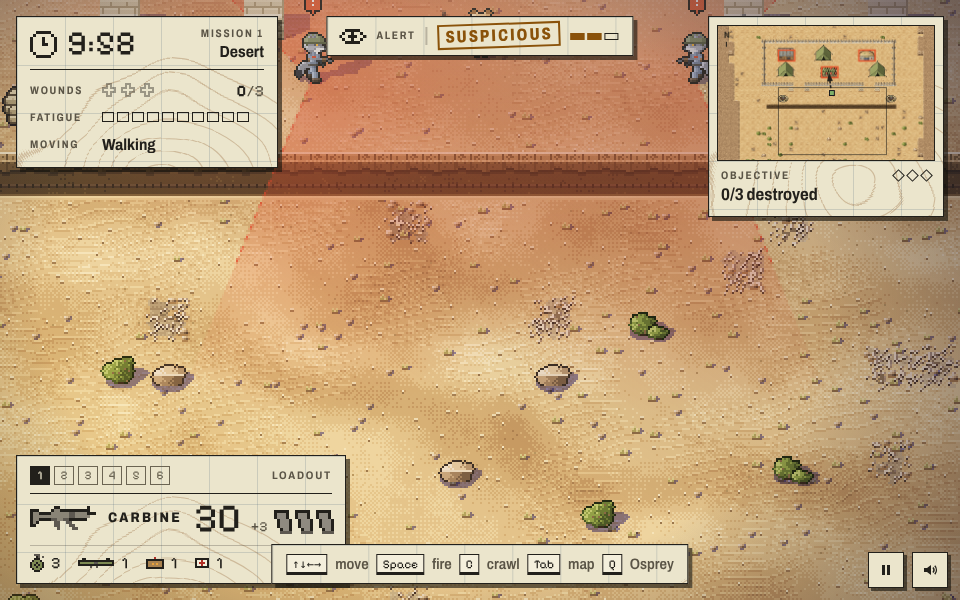
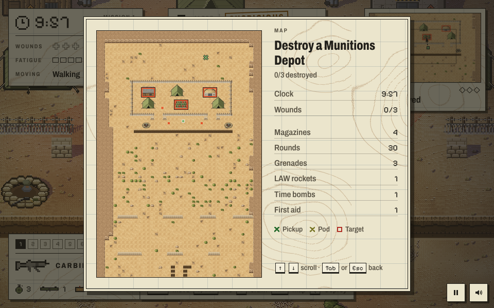
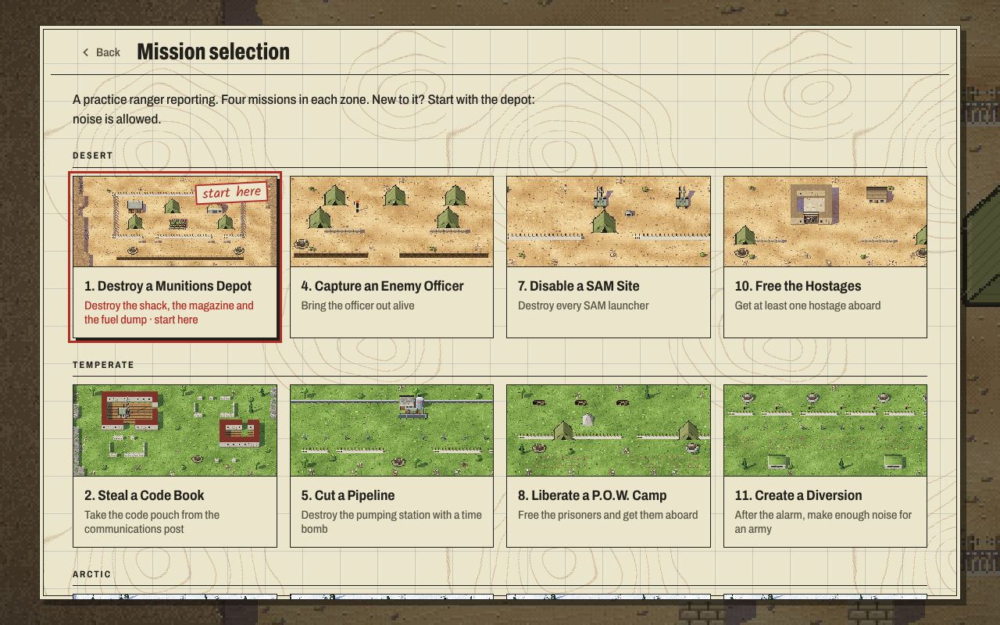
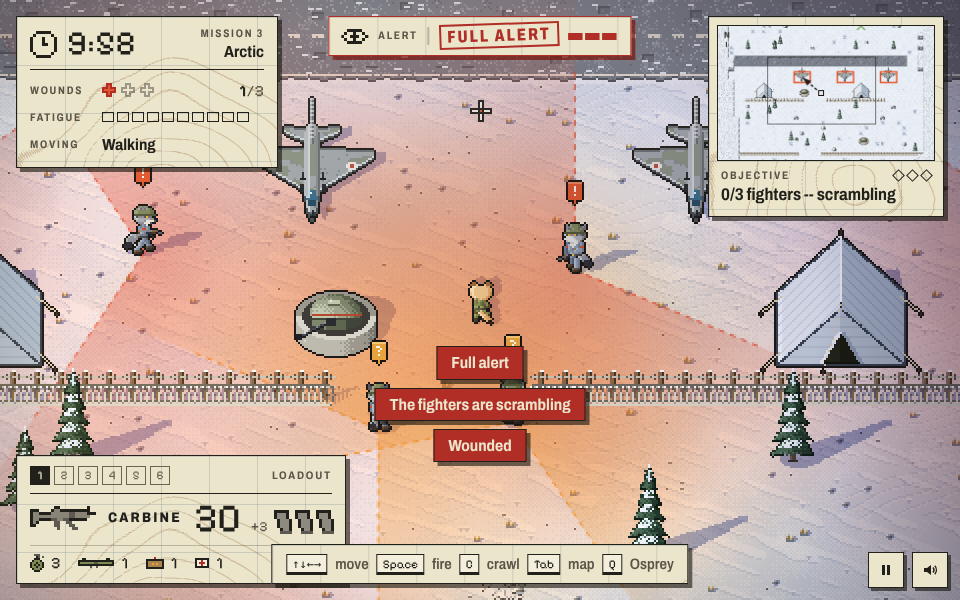
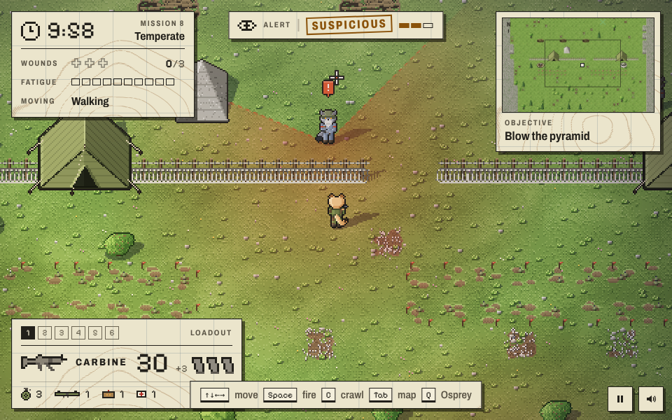
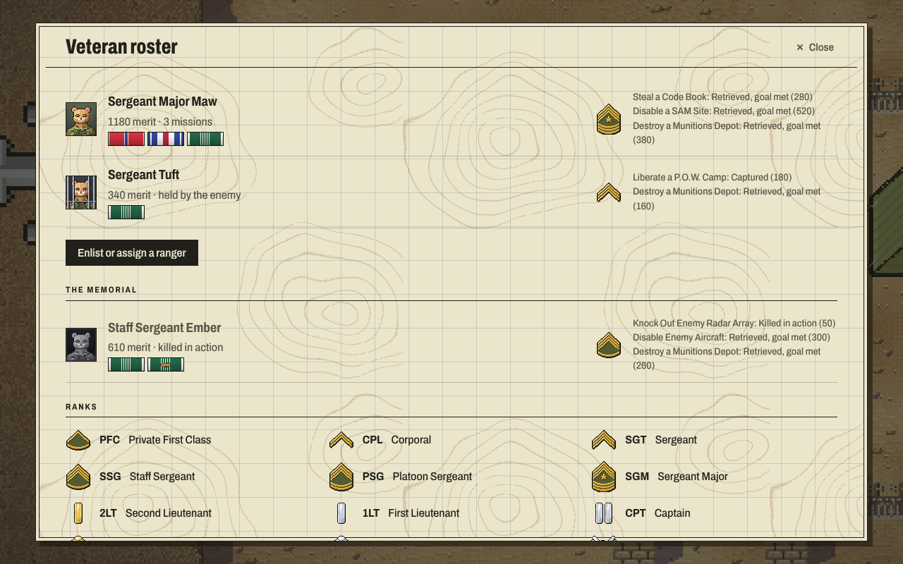

# Airborne Puma

**Twelve missions behind enemy lines.** A remake of *Airborne Ranger* (MicroProse, 1987, Commodore 64): the ranger is a puma, the enemy are wolves, and it is drawn as modern pixel art in the original's tilted overhead view.

## Play

[greykit.com/games/airbornepuma](https://greykit.com/games/airbornepuma/)

No install required. Plain scripts, no build step, nothing fetched at play time: every picture is drawn and every sound synthesised in the page; the two typefaces ship with it.

## How it plays

The Osprey brings you in over the north end of the mission area, past the objective, toward the drop zone at the south end; the whole strip scrolls by once. Kick out your three **supply pods** where you will want them (not into a ditch, onto rocks, wire or water), and jump on the green light. Steer the parafoil down.

On the ground the **clock** is running. Walk, run (the fatigue bar) or crawl; trenches, scrub and walls hide you. Get to the objective, do what the orders say, then **recall the Osprey**: it comes back to the pickup point, lets down a ladder and waits a little while. Miss it when the clock has run out and you are captured. Three wounds and you are killed in action.

The kit is the 1987 kit: a carbine and four magazines, three grenades, one LAW rocket, one time bomb, one first aid kit, the knife, and whatever is in the pods. The enemy patrols, investigates noises, chases what it sees, and on **full alert** -- a shot or an explosion anyone hears -- converges and calls in reinforcements. Machine-gun nests, bunkers, turrets, motion-sensing mini-bunkers, minitanks, minefields and wire are in the way.

The twelve missions, four to a zone:

| Desert | Temperate | Arctic |
|---|---|---|
| 1 Destroy a Munitions Depot | 2 Steal a Code Book | 3 Disable Enemy Aircraft |
| 4 Capture an Enemy Officer | 5 Cut a Pipeline | 6 Knock Out Enemy Radar Array |
| 7 Disable a SAM Site | 8 Liberate a P.O.W. Camp | 9 Photograph a Secret Experimental Aircraft |
| 10 Free the Hostages | 11 Create a Diversion | 12 Delayed Sabotage |

The desert tires you faster; the snow muffles sound and hides thin ice. Every mission area is laid out new each time from modular pieces, as in 1987, and proved finishable before it is used.

## Rangers, ranks and the campaign

A **practice ranger** is anyone, and nothing is kept. A **veteran** is enlisted by name and kept in this browser, as the C64 kept them on a Roster Diskette: their merit, their rank (PFC to Lieutenant Colonel), their decorations (two Army Commendation Medals, the Bronze and Silver Stars, the Distinguished Service Cross), and every mission they flew. Captured, they wait in the enemy's camp until another ranger frees them on mission 8; killed in action, they go to the memorial. The **campaign** is all twelve missions in a fixed order at one difficulty: only there can a ranger make Colonel, or win the Medal of Honor.

## Classic and Field

**Classic** is the 1987 game: the indicators in the corner and nothing more, run and crawl as toggles, pods carried as weight, a mission played through. **Field**, the default, adds a minimap, arrows to the targets and the pickup, the mission's progress and the alarm state, `?` and `!` over soldiers who suspect or see you, fly-over guidance, Shift held to run, mouse aim, the carbine back in hand after a throw, pods that unpack, and leaving a mission to resume later. Settings has every aid on its own; `L` switches the set mid-mission. Settings also has scanlines, and the game speed (fifty steps a second, as the C64, or forty or sixty).

## Keys

| | |
|---|---|
| Arrows, WASD, numpad | move |
| `Space` or `J` | fire; hold it and turn to swing the crosshair; `,` `.` fine aim |
| `Shift` / `R` | run (held, or a toggle) |
| `C` | crawl |
| `1`–`6` or `F1` `F3` `F5` `F7` | carbine, grenade, LAW, knife, time bomb (again: next fuse), first aid |
| `E` | use: open a pod, kick a lever, raid a shack |
| `H` / `Delete` | first aid |
| `Q` / `` ` `` | recall the Osprey |
| `Tab` | the map |
| `Esc` / `P` | pause |
| `L` | Classic or Field aids |
| `M` | sound |

A gamepad works. It is a desktop game: on a phone or a small window the page says so instead.

## What's in here

| | |
|---|---|
| `index.html` | the page: the 480×300 play screen, the title, the note for small screens |
| `css/gk-tokens.css` | the Tactical palette, byte for byte from games-meta `canon/` (STANDARD.md §4) |
| `css/airbornepuma.css` | the page, the HUD, and the screens with words on them: a paper map sheet over the field, grease pencil for what matters |
| `fonts/` | Archivo, Kalam (the grease pencil) and Pixelify Sans (SIL Open Font License; the licences are beside them) |
| `js/gk-title.js` | the greykit.games boot, byte for byte from games-meta `canon/` (§3); the title after it is the game's own, in `js/main.js` |
| `js/engine/*.js`, `js/util.js`, `js/tiles.js`, `js/missions.js` | the game itself, with no DOM in it: map generation, the ranger, weapons, the enemy, the alert, the twelve missions, the airdrop, extraction, merit |
| `js/engine/bot.js` | a ranger with no imagination, for the tests (not loaded by the page) |
| `js/kit.js` | what the play screen's art shares: 480×300, 24-pixel tiles, the low sun and its shadows, the zones' colour ramps |
| `js/ground.js`, `js/things.js`, `js/people.js` | the ground and what stands on it; installations, the Osprey, pods and effects; the puma and the wolves |
| `js/palette.js`, `js/art.js` | the old sixteen-colour art still used for portraits, rank insignia and ribbons |
| `js/render.js`, `js/hud.js` | the play screen (and the title's picture), and the paper labels over it |
| `js/sfx.js` | Web Audio: the effects, the loops, the title march |
| `js/input.js`, `js/career.js`, `js/screens.js`, `js/main.js` | controls, the roster and settings, the sheets, and the loop |
| `tools/sim-check.js` | headless: the rules, the bot winning every mission, a replay matching tick for tick |
| `tools/mapcheck.js` | headless: every mission's map at every difficulty over many seeds, provably finishable (`--show mission:seed:diff` prints one) |
| `tools/stamp-assets.js` | stamps each script and stylesheet URL with its content hash; CI fails on a stale one, so run it before committing |
| `tools/check-assets.js` | every file the page names exists (games-meta STANDARD.md §10) |
| `tools/make-icons.js`, `tools/og.html` | `icon.svg`, the favicons and the home-screen icon (also the GitLab avatar) from one 40×40 drawing of the ranger under his parafoil; the share card, `og.png`, drawn in the play screen's own art |
| `screenshots/` | the pictures in this file: the field at twice the play screen's size, the screens with words at 1280×800 |

`?play=<mission>&diff=<0-3>&seed=<n>&land=1` on the page drops straight into a practice mission, for testing.

## Saves

Everything is in `localStorage` under keys starting `airbornepuma_`: the roster, a mission in progress, settings, sound. Settings → *Forget everything* clears exactly those.

## Not included

The original *Airborne Ranger* disks may sit beside this repo for reference. They are MicroProse's, they are gitignored, and nothing of theirs -- code, art, sound or text -- is in this game. The briefings, maps, numbers and the march are ours, guessed where the 1987 manual is silent.

## License

MIT. See [LICENSE](LICENSE).
